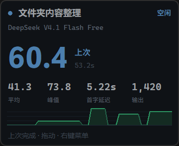
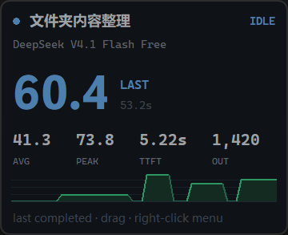
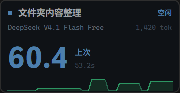
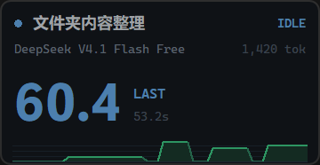
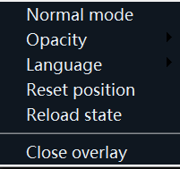

# OpenCode TPS Overlay

English | [简体中文](README.md)

[](https://github.com/GarrulousSparrow/opencode-tps-overlay/actions/workflows/ci.yml)


A standalone always-on-top TPS overlay for **OpenCode V2 Desktop**.

- The OpenCode plugin subscribes to the V2 event stream, computes metrics, and writes `state.json`.
- The Python + tkinter overlay reads `state.json` and renders live metrics above other windows.
- It does not modify the OpenCode Desktop UI and does not inject anything into Electron.

## Features

- Live estimated TPS, real decode TPS, end-to-end TPS, average TPS, peak TPS, TTFT, and output token count
- 60-second sparkline with brightness distinguishing estimated and usage-backfilled points
- Link diagnostics: delta arrival gaps, burst ratio, stalls, and `streamHealth`
- Online CJK / non-CJK ratio calibration
- Keeps the last completed metrics while idle and labels them as `LAST` / `上次`
- Busy-session count
- Always on top, borderless, draggable, hidden from the taskbar
- Saves position, opacity, compact mode, and language
- Automatically launches the overlay (can be disabled)
- Optional `tps` tool so models or commands can query the current metrics
- Chinese UI by default, English UI available from the right-click menu

## Screenshots

| View | Chinese | English |
| --- | --- | --- |
| Normal mode |  |  |
| Compact mode |  |  |
| Context menu |  |  |

The `60.4` in the screenshots is the `LAST` state: the `decodeTps` of the previous completed run.

## Directory Structure

Repository root (installed as `%USERPROFILE%\.config\opencode\plugins\tps-overlay`):

```
tps-overlay\
├─ index.js          # OpenCode V2 plugin
├─ overlay.py        # Python tkinter overlay
├─ locales\
│  ├─ zh-CN.json     # Chinese UI
│  └─ en.json        # English UI
├─ package.json      # ESM package entry and metadata
├─ install.ps1       # Installer (shortcuts / launcher)
├─ deploy.ps1        # Dev helper: copy sources into the plugin directory
├─ test-metrics.mjs  # Synthetic metric tests (no provider)
├─ .github\workflows\ci.yml  # CI: syntax check + metric tests
├─ docs\screenshots\  # README screenshots (zh / en)
├─ .editorconfig
├─ .gitattributes
├─ .gitignore
├─ CHANGELOG.md      # Version history
├─ LICENSE           # MIT
├─ README.md         # Chinese README
└─ README.en.md      # This file
```

Runtime files are stored in:

```
%LOCALAPPDATA%\opencode-tps-overlay\
├─ state.json      # Live state written by the plugin
├─ window.json     # Window position / opacity / compact mode / language
├─ overlay.pid     # Current overlay process ID
├─ launch-overlay.cmd  # Launcher created by install.ps1
├─ plugin.log      # Plugin log
├─ overlay.log     # Overlay log
└─ events.jsonl    # Only created when TPS_OVERLAY_DEBUG=1
```

`install.ps1` also creates an `OpenCode TPS Overlay` Start Menu shortcut. With `-Startup`
it adds a shortcut to the current user's Startup folder.

## Requirements

- Windows 10 / 11
- OpenCode V2 Desktop
- Python 3.8+ with tkinter (the official Windows installer includes it)
- The OpenCode V2 desktop CLI:

```
C:\Users\<username>\AppData\Local\Programs\@opencodedesktop\resources\opencode-cli.exe
```

> **Note:** do not use the `opencode` command from PATH to verify V2 plugins.
> It is usually the V1 CLI and does not load V2 plugins. Use the `opencode-cli.exe`
> path above or check the OpenCode Desktop logs instead.

## Installation

### Option 1: clone from GitHub (recommended)

```powershell
git clone https://github.com/GarrulousSparrow/opencode-tps-overlay.git "$env:USERPROFILE\.config\opencode\plugins\tps-overlay"
cd "$env:USERPROFILE\.config\opencode\plugins\tps-overlay"
powershell -ExecutionPolicy Bypass -File .\install.ps1 -Launch
```

Without `git`, download the repository ZIP and extract it to the same directory, keeping the
`tps-overlay` folder name (overwrite it the same way to update).

Restart OpenCode Desktop after cloning; the plugin is discovered and loaded automatically.

### Option 2: copy manually

Copy the whole repository directory to:

```
%USERPROFILE%\.config\opencode\plugins\tps-overlay
```

Then continue with the steps below:

1. Check Python and tkinter:

   ```powershell
   python -c "import tkinter; print(tkinter.TkVersion)"
   ```

2. Run the installer (optional; creates the launcher and Start Menu shortcut):

   ```powershell
   cd "$env:USERPROFILE\.config\opencode\plugins\tps-overlay"
   powershell -ExecutionPolicy Bypass -File .\install.ps1
   ```

3. Restart OpenCode Desktop. The plugin is discovered automatically and tries to launch the overlay.

4. Confirm that the plugin loaded:

   ```powershell
   Get-Content "$env:LOCALAPPDATA\opencode-tps-overlay\plugin.log" -Tail 20
   ```

   You should see `starting`, followed by `overlay spawned` or `overlay already running`.

## Installer Options

```powershell
# Check the environment and create the Start Menu shortcut
.\install.ps1

# Also add the overlay to the current user's Startup folder
.\install.ps1 -Startup

# Start the overlay after installing
.\install.ps1 -Launch

# Use a specific Python installation
.\install.ps1 -Python "C:\Python311\python.exe"

# Remove shortcuts and stop the overlay (plugin files are kept)
.\install.ps1 -Uninstall
```

If you do not use `install.ps1`, start the overlay directly:

```powershell
pythonw "$env:USERPROFILE\.config\opencode\plugins\tps-overlay\overlay.py"
```

## Usage

| Action | Result |
| --- | --- |
| Left-drag | Move the overlay; the position is saved on release |
| Double-click | Toggle compact / normal mode |
| Right-click | Menu: compact mode, opacity, language, reset position, reload state, close |
| `Close overlay` / `关闭悬浮窗` | Close the overlay; OpenCode starts it again next time |

Compact mode shows the title, model, the large speed value (`DECODE` or `TPS`), sparkline, and output token count.
Normal mode also shows `AVG` / `平均`, `PEAK` / `峰值`, `TTFT` / `首字延迟`, and `OUT` / `输出`.

The overlay defaults to Chinese. Use **Language → English** in the right-click menu to switch,
or set `TPS_OVERLAY_LANG=en` before starting it. The menu selection is saved to `window.json`.

## Metrics

Schema 2 separates the estimated speed from the real decode speed. The large overlay number
prefers `decodeTps` and labels it `DECODE`; before any real usage arrives it falls back to
`liveTps` and keeps the `TPS` label.

| Metric | Meaning |
| --- | --- |
| `decodeTps` | **Real model decode speed** = usage tokens / pure decode time; pure decode time = step duration − that step's own TTFT. Only steps lasting ≥ 500 ms update it, and the decode window has a 250 ms floor |
| `e2eTps` | Throughput the user actually experiences = usage tokens / (`session.step.ended` − `session.execution.started`), including queueing, prefill, TTFT, and tool gaps |
| `liveTps` / `tps` | Live estimate from streaming deltas over roughly the last 5 seconds, measured from the step start, with `liveTpsSource: "estimated"` |
| `avgTps` / `AVG` | **Step-level throughput including TTFT** = usage tokens from measurable steps (duration ≥ 500 ms) / total duration of those steps. Shorter steps only count toward `OUT`, so tool-call steps cannot pass as fast decoding |
| `peakTps` / `PEAK` | Only steps with `tokens >= 32` and `durationMs >= 500`; the live estimate is used only when no step has completed in the run. `peakSource` is `"usage"` or `"estimated"` |
| `TTFT` | Milliseconds from `session.execution.started` to the first text/reasoning delta |
| `OUT` | Actual output tokens for the current run |
| `LAST` | Idle state; metrics of the last completed run |

Every published rate (`liveTps`, `decodeTps`, `e2eTps`, `avgTps`, `peakTps`, and the
sparkline) is clamped to 0–2000 tok/s, so a bad sample can no longer push the number into
the tens or hundreds of thousands.

`avgTps` includes TTFT, so it is normally much lower than `decodeTps`. A long TTFT makes
the gap larger; that is a definition difference, not a bug.

### Character estimate and calibration

The live estimate splits text into two classes:

- `cjkRatio`: tokens per CJK character (Han, kana, Hangul), default `0.65`, clamped to `0.4 ~ 1.0`
- `nonCjkRatio`: ratio for other characters, default `0.30`, clamped to `0.1 ~ 0.6`

After each usage-backed step, the plugin adds the step's CJK count, non-CJK count, and
`tokens.output` to a 16-sample window and fits both ratios with least squares.
Fewer than 3 step samples means no calibration, which avoids single-step noise.

### Sparkline semantics

`spark` still stores the per-second peak for the last 60 seconds, but each point now carries
a source marker:

- `sparkSource[i] = 0`: character-based estimate
- `sparkSource[i] = 1`: real usage backfill after a step ends

Bright green is usage-backed; dim green is estimated. When a step ends, the plugin overwrites
the estimate for the covered time range with the usage-derived rate, so the two series do not
contradict each other.

The state also reports:

- `sparkMaxUsage`: highest usage-backed point in the current window
- `sparkMaxEstimated`: highest value the estimator actually reached in the window, even if
  that point was later overwritten by usage

A large gap between them means bursts or CJK ratio errors are significantly inflating the
estimator.

## Link diagnostics

`onDelta` records the arrival gap between adjacent deltas and keeps only the latest 200 in
memory. Nothing is logged per delta and there is no per-delta disk IO. The session object in
`state.json` exposes:

| Field | Meaning |
| --- | --- |
| `gapP50Ms` / `gapP95Ms` / `gapMaxMs` | Median / P95 / max delta arrival gap |
| `burstRatio` | Fraction of gaps below 30ms |
| `stallCount` | Number of gaps above 500ms |
| `streamHealth` | `smooth` / `bursty` / `stalled` |

Rules:

- `burstRatio > 0.6` and `stallCount > 2` → `bursty`
- otherwise `gapP95Ms > 800` → `stalled`
- otherwise `smooth`

How to read it:

- `bursty` / `stalled`: deltas arrive in batches or stop for long periods. This is usually
  SSE/proxy/network buffering, so the instantaneous `liveTps` spikes are not trustworthy.
- `smooth` with low `decodeTps`: the link is fine; the provider itself is decoding slowly.
- `smooth` with high `decodeTps`: both model and link are healthy.

While busy, the overlay footer shows `streamHealth`, P95 gap, and stall count.

## Configuration

The plugin and overlay read these environment variables:

| Variable | Default | Description |
| --- | --- | --- |
| `TPS_OVERLAY_DATA_DIR` | `%LOCALAPPDATA%\opencode-tps-overlay` | State and log directory |
| `TPS_OVERLAY_LANG` | `zh-CN` | UI language: `zh-CN` or `en`; overrides the saved selection |
| `TPS_OVERLAY_AUTOSTART` | `1` | Set to `0` to stop the plugin from launching the overlay |
| `TPS_OVERLAY_DEBUG` | `0` | Set to `1` to write `events.jsonl` and step calibration details |
| `TPS_OVERLAY_PYTHON` | Auto-detect `pythonw.exe` / `python.exe` | Python executable |
| `TPS_OVERLAY_POLL_MS` | `200` | Overlay polling interval for `state.json`, 100–2000 |
| `TPS_OVERLAY_ALPHA` | Saved value or `0.92` | Initial opacity, 0.28–1.0 |

Example (current PowerShell session only):

```powershell
$env:TPS_OVERLAY_DEBUG = "1"
$env:TPS_OVERLAY_POLL_MS = "150"
$env:TPS_OVERLAY_LANG = "en"
```

To apply these variables when OpenCode Desktop starts, set them before launching OpenCode
or configure them as user-level environment variables.

## `tps` Tool

The plugin tries to register a tool named `tps`. Its output looks like:

```
OpenCode TPS (live)
- BUSY Current session (deepseek-v4.1-flash-free): tps=514.9 avg=116.9 peak=1408.3 ttft=102ms out=20610 decode=132.4 e2e=98.7 link=smooth/p95:24ms/stall:0
State file: C:\Users\...\AppData\Local\opencode-tps-overlay\state.json
```

Pass `sessionID` to inspect a single session; without it, the six most recent sessions are listed.
Since 1.1.0 the existing line is extended with `decode=`, `e2e=`, and `link=`; no existing
field is renamed or removed.

## State file and performance

- The `state.json` `schema` is now `2`; all new fields are additive, so an older `overlay.py`
  can still read the file.
- The new `overlay.py` degrades when `decodeTps`, `sparkSource`, or `streamHealth` is missing:
  the big number shows `tps`, the sparkline keeps the old single-color style, and no link row
  is shown.
- State content is still produced every `TICK_MS = 300ms`, but writes are asynchronous and
  atomic. Unchanged content is skipped, with a one-second heartbeat so the overlay does not
  falsely report `OFFLINE`.
- Each delta only updates in-memory counters and the rolling windows: no synchronous disk IO
  and no O(n²) work.

## Tests

`test-metrics.mjs` feeds synthetic events without a real provider or a real `state.json`:

```powershell
cd "$env:USERPROFILE\.config\opencode\plugins\tps-overlay"
node .\test-metrics.mjs
```

It covers smooth streams, burst streams, short steps, TTFT separation, CJK calibration, and
reasoning/text deduplication.

## Development

The repository is the complete plugin source; there is no build step. Verify and deploy changes
with:

```powershell
# Syntax check + metric tests (the same steps CI runs)
node --check index.js
npm test              # same as node .\test-metrics.mjs

# Deploy into the global OpenCode plugin directory
powershell -ExecutionPolicy Bypass -File .\deploy.ps1
```

- `deploy.ps1` only copies files and never deletes anything in the destination. It targets
  `%USERPROFILE%\.config\opencode\plugins\tps-overlay` by default; override it with `-Destination`.
- Changes to `index.js` require a plugin reload or an OpenCode Desktop restart.
- Changes to `overlay.py` require closing and reopening the overlay.
- Before committing, make sure `.gitignore` covers `state.json`, `window.json`, `*.log`, and other
  runtime files.
- When bumping the version, update `package.json`, `VERSION` in `index.js`, and `CHANGELOG.md`.

Issues and pull requests are welcome; please make sure `npm test` passes first.

## Troubleshooting

### The overlay does not appear

1. Check `plugin.log`:
   - `overlay script missing`: `overlay.py` is not in the plugin directory, or it was added after the plugin loaded. Restart OpenCode.
   - `unable to start overlay: no Python executable found`: set `TPS_OVERLAY_PYTHON` or add Python to PATH.
   - `overlay already running`: an instance is already active; check `pythonw.exe` in Task Manager.
2. Check `overlay.log`:
   - `tkinter could not create a window`: Python is missing tkinter; reinstall the official Python build.
   - `another overlay instance is already running`: the named mutex blocked a second instance; this is expected.

### `OFFLINE` is displayed

`state.json` has not been updated for longer than `staleAfterMs` (5 seconds by default).
Usually this means OpenCode exited, the plugin stopped, or the event stream failed.
Check `plugin.log` for `event stream error`.

### It stays on `WAITING` / `等待中`

The plugin is loaded but has not received any session events yet. Send a message in OpenCode.
If it still does not update, check whether `state.json` is changing.

### TPS is noticeably too high or too low

First check whether the big number is labelled `DECODE` or `TPS`:

- `DECODE`: real usage, excluding only TTFT; this is the model decode speed.
- `TPS`: character estimate, affected by CJK ratios and link buffering.

If `liveTps` / `sparkMaxEstimated` look too high, compare `streamHealth`:

- `bursty` / `stalled`: link buffering, not the model getting faster.
- `smooth` with low `decodeTps`: the provider is genuinely slow.
- `cjkRatio` / `nonCjkRatio` calibrate automatically after a few steps.

Numbers in the tens or hundreds of thousands (for example `120000.0`) come from the
1.1.0 and earlier bug where a tool-call step reused the run-level TTFT. That step has no
first token of its own, so its decode window collapsed to 1 ms. Since 1.1.1 such short
steps no longer set a rate, and every rate is clamped to 2000 tok/s.

### The overlay covers something / cannot be closed

Right-click and choose `Close overlay` / `关闭悬浮窗`. If the window does not respond, end the
matching `pythonw.exe` in Task Manager, or delete `overlay.pid` and start it again.

### Duplicate overlays

The overlay uses a named mutex, so only one instance per Windows login session can run.
Multiple instances across different Windows login sessions are expected because `Local\`
namespaces are session-specific.

## Privacy

- By default only metrics and session titles are written; prompts and model output are not.
- With `TPS_OVERLAY_DEBUG=1`, `events.jsonl` records full event payloads, which may include
  prompts, model output, and tool arguments.
- Disable the variable after debugging and delete `events.jsonl`.

## Uninstall

1. Right-click the overlay and choose `Close overlay` / `关闭悬浮窗`.
2. Run:

   ```powershell
   powershell -ExecutionPolicy Bypass -File .\install.ps1 -Uninstall
   ```

3. Delete the plugin directory:

   ```powershell
   Remove-Item -Recurse -Force "$env:USERPROFILE\.config\opencode\plugins\tps-overlay"
   ```

4. Optionally delete the runtime data:

   ```powershell
   Remove-Item -Recurse -Force "$env:LOCALAPPDATA\opencode-tps-overlay"
   ```

## Known Limitations

- Depends on OpenCode V2 event names and payloads. V2 is still evolving; if the event shape
  changes after an upgrade, `index.js` may need an update.
- `liveTps` is an estimate; `decodeTps` / `e2eTps` / `AVG` / `PEAK` / `OUT` come from actual usage.
- `streamHealth` only observes delta arrival cadence; it cannot tell whether buffering comes
  from a proxy, SSE, or the downstream network.
- The overlay is a separate Python process and does not use the OpenCode Desktop renderer.

## License

Released under the [MIT License](LICENSE).
